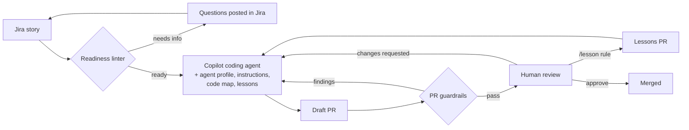
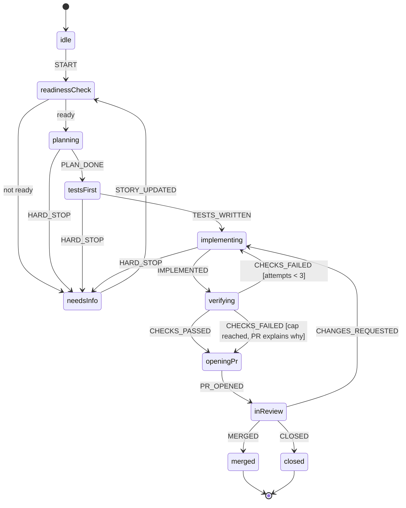

# Story-to-PR Agent

**Turn Jira user stories into reviewed pull requests with the GitHub Copilot coding agent — safely, cheaply, and getting better every sprint.**

**[Live demo](https://ravitejabandaru.github.io/story-to-pr-agent/demo/)** (after GitHub Pages is enabled) · [`demo/index.html`](demo/index.html)

[](https://github.com/ravitejabandaru/story-to-pr-agent/actions/workflows/ci.yml)


Copilot's coding agent can already take a Jira story and open a pull request. On its own, it will guess when a story is vague, wander around large repos spending tokens, and occasionally "fix" a red build by skipping a test. **Story-to-PR Agent is the harness around it** that makes the output something a team can trust:

| | What it does | Why it matters |
|---|---|---|
| 🚦 **Readiness linter** | Scores a story against the Definition of Ready *before* it reaches the agent, and writes the exact questions to post back in Jira. | Vague stories are caught in milliseconds for zero tokens, instead of costing a full agent session and a rejected PR. |
| 🧭 **Lifecycle statechart** | The run (ready check → plan → tests first → implement → verify → PR → review) as an [XState](https://stately.ai/docs/xstate) machine with guards. | The rules aren't just prose in a prompt: no coding before readiness, tests before code, a hard cap on fix loops, hard stops back to a human. |
| 🛡️ **PR guardrails** | A GitHub Action that checks every agent PR: Jira traceability, the PR contract, scope, protected paths, deleted/skipped/weakened tests, new dependencies. | The agent is *told* the rules; this *enforces* them, deterministically, on every push. |
| 🔁 **Lessons loop** | A reviewer comments `/lesson <rule>` → a PR adds the rule to the agent's instructions. | Every mistake is fixed once, not every sprint. The agent visibly improves over time. |
| 📚 **Agent templates** | Agent profile, repo instructions, a JSON→LWC renderer guide, a code map, a quiet `agent:check` script, and a pre-built environment. | Precision and lower token use come from what the agent reads — see [docs/efficiency.md](docs/efficiency.md). |

## How it fits together



## The run lifecycle



Details and how to visualise it in Stately: [docs/lifecycle.md](docs/lifecycle.md).

## Try it in 30 seconds

```bash
git clone https://github.com/ravitejabandaru/story-to-pr-agent && cd story-to-pr-agent
npm ci
npm test                      # 25 tests: readiness, lifecycle, guardrails, lessons
npm run readiness:demo        # a ready story vs. a vague multi-repo one
npm run lifecycle:demo        # a story walked through the statechart
node src/guardrails/cli.js --pr examples/prs/bad-pr.json   # a PR that games the build
```

What the guardrails say about that bad PR:

```text
### ❌ Story-to-PR guardrails: 7 error(s), 1 warning(s)
❌ title            PR title must start with the Jira key
❌ sections         PR description is missing sections: Acceptance criteria → evidence, …
❌ protected-paths  Protected paths changed (needs a human): …/Billing_Agent.permissionset-meta.xml
❌ deleted-tests    Test files deleted: …/invoiceList.test.js
❌ skipped-tests    billingTab.test.js adds a skip/only/ignore: "it.skip('shows overdue badge' …"
⚠️ weakened-tests   billingTab.test.js removes 2 assertion(s) and adds 0
❌ dependencies     package.json adds or changes dependencies (needs approval): "moment": "^2.30.1"
```

## Use it in your repositories

1. Copy [`templates/repo/`](templates/repo) into each target repo and fill in the `<PLACEHOLDERS>`, starting with `docs/agent/code-map.md` and `.github/copilot-instructions.md`.
2. Add `"agent:check": "bash scripts/agent-check.sh"` to the repo's `package.json`.
3. Make **Story-to-PR guardrails** a required status check in branch protection.
4. Paste [`templates/jira-story-template.md`](templates/jira-story-template.md) into your Jira issue template.
5. Assign a ready story to Copilot in Jira.

Full guide: [docs/adoption.md](docs/adoption.md).

## Repository layout

```text
src/
  readiness/    parse-story.js, score-story.js, cli.js   → zero-token Definition of Ready
  lifecycle/    machine.js                                → XState v5 statechart
  guardrails/   check-pr.js, glob.js, cli.js              → agent PR contract checks
  lessons/      add-lesson.js, cli.js                     → /lesson → instructions
actions/
  guardrails/   composite action used by target repos
  lessons/      composite action used by target repos
templates/      everything a target repo needs (.github/, code map, check script, Jira template)
examples/       sample stories and PRs used by tests and demos
docs/           efficiency, lifecycle, adoption
```

## Design choices

- **Deterministic before generative.** Anything that can be a rule (readiness, naming, test integrity) is code, not a sentence in a prompt. It's free, instant and can't be talked out of.
- **Small, stable context.** A code map, `applyTo`-scoped instructions, and a check script that prints only failures keep the agent's input small. Since June 2026 Copilot bills agent work by tokens, so this is a direct cost lever.
- **Humans stay in the loop where it counts.** Hard stops for dependencies, schema breaks and security changes. Draft PRs only. Lessons land via PRs a human approves.
- **Zero runtime dependencies** for the Actions (guardrails and lessons run on plain Node 20). XState is only used for the lifecycle model.

## Metrics worth tracking

Credits per *merged* PR · % merged without changes · review rounds per PR · story → PR time vs. the manual baseline · % of stories sent back by the readiness linter (and why). The lifecycle's `outcomeOf()` gives the outcome label for each run.

## License

MIT © Raviteja Bandaru
